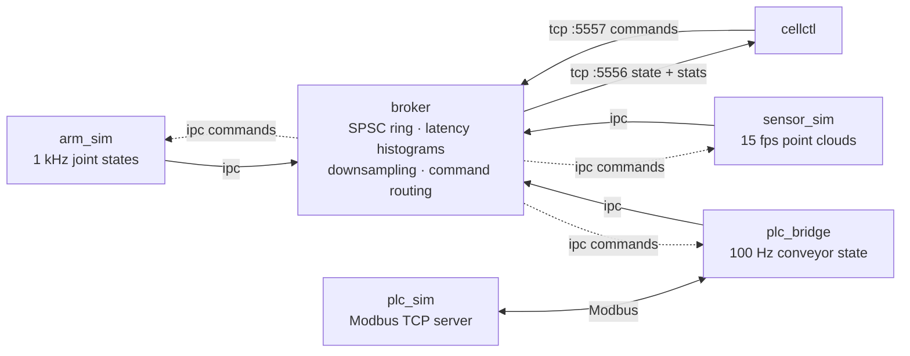

# cell-runtime

[](https://github.com/youssefehaab/Cell-runtime/actions/workflows/ci.yml)

A Linux runtime for a simulated industrial robot cell, in C++20 with Python
tooling. It is the controller-side software of a cell without the hardware: a
6-axis arm publishing joint states at 1 kHz, a depth sensor streaming 3.7 MB
point clouds, and a conveyor PLC reached over Modbus TCP, all feeding a broker
that measures latency and loss on every stream through a lock-free pipeline. An
operator CLI shows the cell live, sends commands and injects faults, and the
deployment side covers systemd units, Docker Compose, and health-gated upgrades
that roll themselves back.

## Architecture



Six processes: four in C++ (`arm_sim`, `sensor_sim`, `plc_bridge`, `broker`) and
two in Python (`plc_sim`, `cellctl`). Details in
[docs/architecture.md](docs/architecture.md).

## Quickstart (Docker Compose)

```
git clone https://github.com/youssefehaab/Cell-runtime.git && cd Cell-runtime
docker compose -f deploy/docker-compose.yml up -d --build --wait
docker compose -f deploy/docker-compose.yml exec broker cellctl status
```

Then try it:

```
alias cellctl='docker compose -f deploy/docker-compose.yml exec broker cellctl'
cellctl health --json                          # exit code 0 = healthy
cellctl cmd arm move-to 0.8 -0.4 0.3 0 0.5 0   # joint targets in radians
cellctl cmd plc speed 0.8                      # conveyor speed in m/s
cellctl fault disconnect-sensor                # watch the dashboard go UNHEALTHY and recover
cellctl fault plc-down                         # PLC outage; plc_bridge reconnects with backoff
```

Stop with `docker compose -f deploy/docker-compose.yml down -v`.

## `cellctl status`

```
╭─ cellctl status ───────────────────────────────────────────────────────────────────────────────────────────────────────────────────────────────────╮
│ cell HEALTHY                                                      broker tcp://127.0.0.1:5556  reachable                                  16:07:53 │
╰────────────────────────────────────────────────────────────────────────────────────────────────────────────────────────────────────────────────────╯
processes
╭────────────┬────────┬───────┬────────┬───────────┬─────────────────────────────────────────────────────────────────────────────────────────────────╮
│ process    │ status │ alive │ uptime │ last seen │ detail                                                                                          │
├────────────┼────────┼───────┼────────┼───────────┼─────────────────────────────────────────────────────────────────────────────────────────────────┤
│ arm_sim    │ OK     │ yes   │  2.0 s │      2 ms │ -                                                                                               │
│ sensor_sim │ OK     │ yes   │  1.9 s │    137 ms │ -                                                                                               │
│ plc_bridge │ OK     │ yes   │  2.0 s │     41 ms │ -                                                                                               │
│ plc_sim    │ OK     │ yes   │  1.8 s │    109 ms │ -                                                                                               │
│ broker     │ OK     │ yes   │  2.0 s │      0 ms │ -                                                                                               │
╰────────────┴────────┴───────┴────────┴───────────┴─────────────────────────────────────────────────────────────────────────────────────────────────╯
╭─ arm ────────────────────────────────────────────────────────────────────────────╮╭─ conveyor ────────────────────╮╭─ sensor ──────────────────────╮
│  mode IDLE           J1      J2      J3      J4      J5      J6                  ││ speed         0.500 m/s       ││ resolution  640 x 480         │
│  position rad    +0.800  -0.400  +0.300  +0.000  +0.500  +0.000                  ││ item present  no              ││ frame seq   29                │
│  velocity rad/s  +0.000  +0.000  +0.000  +0.000  +0.000  +0.000                  ││ fault code    0 (none)        ││ frame size  3.69 MB           │
│                                                                                  ││ link up       yes             ││ frame age   7 ms              │
╰──────────────────────────────────────────────────────────────────────────────────╯╰───────────────────────────────╯╰───────────────────────────────╯
streams (1000 ms window)  ring high-water 3 / 65,536
╭─────────────────┬───────────┬─────────┬───────────┬───────────┬───────────┬───────────┬───────┬────────┬──────────────┬─────────────┬──────────────╮
│ stream          │   rate Hz │    msgs │    p50 µs │    p99 µs │   p999 µs │    max µs │  gaps │  drops │   total msgs │  total gaps │  total drops │
├─────────────────┼───────────┼─────────┼───────────┼───────────┼───────────┼───────────┼───────┼────────┼──────────────┼─────────────┼──────────────┤
│ arm.joint       │     999.7 │   1,000 │     147.5 │     417.8 │   1,339.7 │   1,339.7 │     0 │      0 │        1,997 │           0 │            0 │
│ sensor.frame    │      15.0 │      15 │   1,900.5 │   3,374.3 │   3,374.3 │   3,374.3 │     0 │      0 │           30 │           0 │            0 │
│ plc.conveyor    │     100.0 │     100 │     139.3 │     303.1 │     381.3 │     381.3 │     0 │      0 │          199 │           0 │            0 │
╰─────────────────┴───────────┴─────────┴───────────┴───────────┴───────────┴───────────┴───────┴────────┴──────────────┴─────────────┴──────────────╯
```

## Build from source

Ubuntu 24.04 (GCC 13 or Clang 18):

```
sudo apt-get install -y build-essential cmake ninja-build pkg-config git \
  libzmq3-dev cppzmq-dev libprotobuf-dev protobuf-compiler libmodbus-dev libsystemd-dev python3-venv
cmake -S . -B build -G Ninja -DCMAKE_BUILD_TYPE=Release && cmake --build build
python3 -m venv .venv && .venv/bin/pip install -r python/requirements.txt

ctest --test-dir build --output-on-failure                       # 213 unit tests
PYTHONPATH=python .venv/bin/python -m pytest tests/integration   # 29 integration tests

PYTHONPATH=python .venv/bin/python -m cellctl up                 # run the cell locally
PYTHONPATH=python .venv/bin/python -m cellctl status             # in another terminal
```

Sanitizer builds: add `-DSANITIZE=address,undefined` or `-DSANITIZE=thread`.

## Benchmarks

End-to-end latency, device publish → broker receive, on a 4-core shared cloud
VM with no real-time tuning (median of 30 one-second windows, µs):

| Load | Stream | Rate (Hz) | Gaps | Drops | p50 | p99 | p999 |
|---|---|---:|---:|---:|---:|---:|---:|
| 1× | `arm.joint` | 995 | 0 | 0 | 172 | 565 | 2,770 |
| 1× | `sensor.frame` | 15 | 0 | 0 | 1,868 | 2,379 | 2,379 |
| 1× | `plc.conveyor` | 100 | 0 | 0 | 156 | 455 | 1,666 |
| 5× | `arm.joint` | 4,976 | 0 | 0 | 68 | 508 | 1,720 |
| 5× | `sensor.frame` | 75 | 0 | 0 | 1,343 | 2,778 | 2,778 |
| 5× | `plc.conveyor` | 500 | 0 | 0 | 81 | 504 | 1,544 |

The SPSC ring moves 682 M items/s single-threaded (1.5 ns per push+pop) against
100 M for a mutex-protected deque. Full tables, worst-case windows and how to
reproduce: [docs/benchmarks.md](docs/benchmarks.md).

## Fault recovery

| Fault | How to inject | What happens |
|---|---|---|
| Process crash | `cellctl fault kill arm_sim` | Supervisor restarts it; the broker reports a restart, not message loss |
| Sensor drop-out | `cellctl fault disconnect-sensor` | Frames stop, heartbeat goes `DEGRADED`, health fails, then recovers |
| PLC outage | `cellctl fault plc-down` | `plc_bridge` reports `link_up=false`, reconnects with exponential backoff |
| Bad release | `deploy/scripts/upgrade.sh <release>` | Health gate fails, previous release is restored automatically |

All four are covered by the integration tests.

## Deployment

- **systemd** — `deploy/systemd/`: one unit per process plus `cell.target`, with
  `Type=notify`, `WatchdogSec` and `Restart=on-failure`.
- **Docker** — `deploy/docker/Dockerfile` (multi-stage, non-root, 217 MB) and
  `deploy/docker-compose.yml`.
- **Releases** — `deploy/scripts/`: `make-release.sh`, `install.sh`,
  `upgrade.sh` (automatic rollback), `rollback.sh`, `healthcheck.sh`. Releases
  live in `/opt/cell-runtime/releases/<version>` behind a `current` symlink.

```
deploy/scripts/make-release.sh build /tmp/stage          # stage a release from a build tree
sudo deploy/scripts/install.sh /tmp/stage --venv --units # first install
sudo deploy/scripts/upgrade.sh /tmp/stage-next           # exit 0 upgraded, 3 rolled back
```

## Palletising algorithms

`src/algo/` holds a greedy pallet-packing heuristic and an axis-aligned
bounding-box collision check, independent of the runtime, with Python bindings
(pybind11). Boxes are placed sturdiest-first at the lowest free corner, subject
to pallet bounds, no collisions, a minimum supported footprint, the pallet
weight limit, and per-box stacking limits with load propagated down the stack.
An independent validator checks every result; a property test runs it over 200
random box sets.

```
PYTHONPATH=build/python python python/demos/pallet_demo.py --boxes 40   # draws each layer
```

The demo's default mix packs 33 of 40 boxes at 90.6 % volume fill. Packing 50
boxes takes 63 µs and 200 boxes 1.1 ms; an AABB check takes 2.3 ns.

## Design decisions

Why ipc inside the cell and tcp at the edge, how the ring buffer's memory
ordering works, why the broker drops instead of blocking, how rollback is made
safe, and what would change for real hardware:
[docs/design-decisions.md](docs/design-decisions.md).

## Repository layout

```
proto/cell.proto      wire contract for every message
src/common/           ring buffer, histogram, config, logging, signals, zmq helpers
src/{arm_sim,sensor_sim,plc_bridge,broker}/
src/algo/             pallet packing + AABB collision, pybind11 bindings
python/{cellctl,plc_sim}/
python/demos/         pallet packing visualisation
tests/unit/           GoogleTest
tests/integration/    pytest, launches the real processes
bench/                Google Benchmark + end-to-end latency benchmark
deploy/               systemd units, Docker, Compose, release scripts
docs/                 architecture, design decisions, benchmarks
```

## Limitations

- Everything is simulated; there is no real hardware and no safety function.
- The systemd units are statically verified (`systemd-analyze verify`) but have
  not been booted on a systemd host.
- Benchmarks come from a shared VM; see the caveats in
  [docs/benchmarks.md](docs/benchmarks.md).
