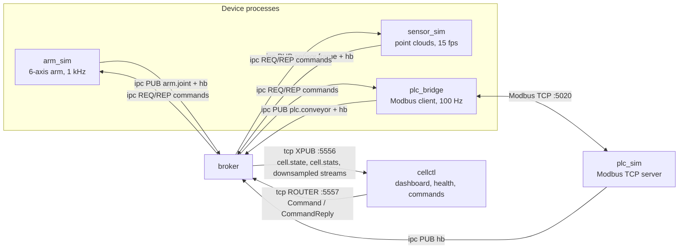
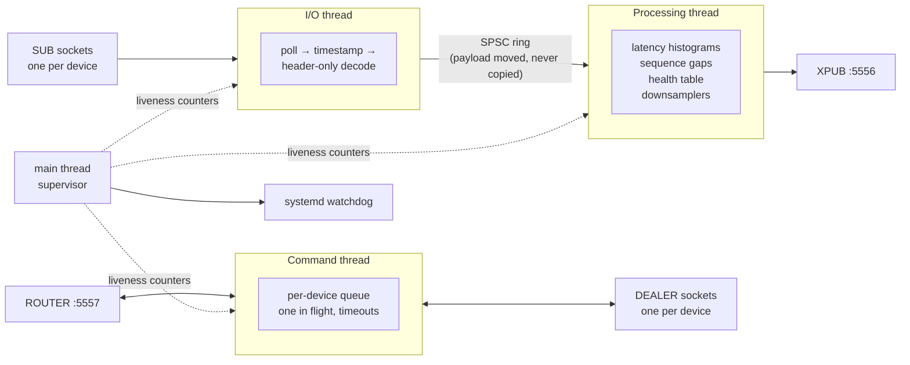

# Architecture

## Processes

| Process | Language | Role |
|---|---|---|
| `arm_sim` | C++ | Simulated 6-axis arm. Publishes `JointState` at 1 kHz; accepts MoveTo, Stop, EStop, Reset. |
| `sensor_sim` | C++ | Simulated depth sensor. Publishes 640×480 `PointCloudFrame`s (3.69 MB) at 15 fps; can simulate a disconnect. |
| `plc_bridge` | C++ | Modbus TCP client. Polls the conveyor PLC at 100 Hz, publishes `ConveyorState`, forwards speed commands, reconnects with backoff. |
| `plc_sim` | Python | pymodbus server simulating the conveyor PLC; can drop off the network on request. |
| `broker` | C++ | Subscribes to every device stream, measures latency and loss, downsamples, aggregates cell state, republishes for consumers, routes commands. |
| `cellctl` | Python | Operator CLI: live dashboard, health, stats, commands, fault injection, logs, local supervisor. |

## Endpoints

| Endpoint | Pattern | Owner |
|---|---|---|
| `ipc:///tmp/cell/arm.telemetry` | PUB | arm_sim |
| `ipc:///tmp/cell/arm.cmd` | REP | arm_sim |
| `ipc:///tmp/cell/sensor.frames` | PUB | sensor_sim |
| `ipc:///tmp/cell/sensor.cmd` | REP | sensor_sim |
| `ipc:///tmp/cell/plc.telemetry` | PUB | plc_bridge |
| `ipc:///tmp/cell/plc.cmd` | REP | plc_bridge |
| `ipc:///tmp/cell/plcsim.telemetry` | PUB | plc_sim (heartbeat only) |
| `tcp://*:5556` | XPUB | broker → consumers |
| `tcp://*:5557` | ROUTER | consumers → broker (commands) |

Every endpoint is a config value (`config/*.json`) and can be overridden on the
command line with `--set key=value`.

## Messages

Defined in [`proto/cell.proto`](../proto/cell.proto). Telemetry is published as
two frames, `[topic][protobuf]`. Every message starts with a `Header`
(`seq`, `send_mono_ns`, `source`) as field 1.

| Topic | Message | Publisher |
|---|---|---|
| `arm.joint` | `JointState` | arm_sim; broker republishes at 50 Hz |
| `sensor.frame` | `PointCloudFrame` | sensor_sim; broker republishes `FrameInfo` (metadata only) |
| `plc.conveyor` | `ConveyorState` | plc_bridge; broker republishes at 50 Hz |
| `hb` | `Heartbeat` | every process |
| `cell.state` | `CellState` | broker, 50 Hz |
| `cell.stats` | `CellStats` | broker, every second |

## Inside the broker

- **I/O thread.** Polls every SUB socket. For each message it takes the receive
  timestamp, decodes only the header, and moves the payload into the ring. If
  the ring is full it counts a drop and moves on; it never blocks.
- **Processing thread.** Pops items, records latency in a log-linear histogram
  per stream, tracks sequence gaps and publisher restarts, keeps the heartbeat
  table, downsamples, and publishes `cell.state` (50 Hz) and `cell.stats` (1 Hz).
- **Command thread.** Accepts commands on the ROUTER, forwards them to the
  target device, and relays the reply. One request in flight per device; a
  timeout answers the client and recreates that device's socket.
- **Main thread.** Starts the workers, and kicks the systemd watchdog only while
  all three are making progress.

Each thread owns its sockets exclusively. The only shared state is the ring and
a few single-writer atomic counters.

## Deployment

| Mode | Supervisor | Notes |
|---|---|---|
| systemd | one unit per process + `cell.target` | `Type=notify`, `WatchdogSec=5`, `Restart=on-failure` |
| Docker Compose | Docker restart policy | one image, ipc sockets on a shared volume |
| local | `cellctl up` | restarts children with backoff; used by tests and development |

Releases live in `/opt/cell-runtime/releases/<version>` with a `current`
symlink; see [design-decisions.md](design-decisions.md#upgrades-and-rollback).
